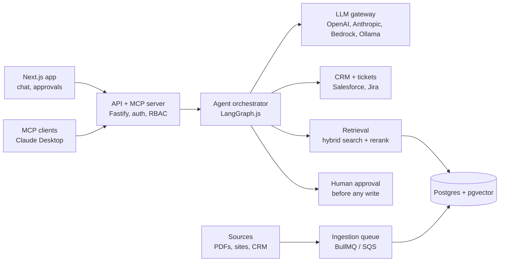

# OpsPilot

> Enterprise AI copilot: answers from company docs with citations and takes actions in CRM and ticketing, with human approval.

**Status:** Phase 1 in progress (Steps 1-2 done)  
**Language:** Node.js / TypeScript  
**Group:** Main portfolio projects  
**Effort:** High (about 12 weeks of evenings)

## The problem

Every AI-engineer job description in 2026 asks for the same core: LLM APIs, RAG with vector databases, agents with tool calling, MCP, evals, and production deployment with security and monitoring. Most backend developers have the backend half but no shipped AI system to show.

OpsPilot is one realistic product that exercises every one of those skills as a real feature, not a toy demo. Staff ask questions over company documents and get cited answers filtered by their permissions, and they give tasks such as "summarise Acme's open tickets and draft a follow-up case". Agents plan the steps, call tools in Salesforce and Jira, and wait for a human to approve anything that writes.

## Who it's for

Support, sales and operations staff in a company that keeps knowledge in PDFs and wikis and work in a CRM and a ticketing system. For the portfolio: recruiters and interviewers for AI engineer, GenAI backend and forward-deployed engineer roles.

## What it does

1. **Ingestion:** crawl websites with Playwright, upload PDFs, sync Jira and Salesforce records; parse, chunk, embed, and re-index only what changed (content hash). Extract tables and fields from messy PDFs into Zod schemas.
2. **Retrieval (RAG):** hybrid search (vector + keyword), metadata filters, permission filter per user role, re-ranking, citations on every answer, and "I don't know" when evidence is weak.
3. **LLM gateway:** one interface over OpenAI, Anthropic, Amazon Bedrock and Ollama; cheap vs strong model routing, Redis cache, tokens and cost per tenant, provider fallback, streaming.
4. **Agent orchestrator:** LangGraph.js supervisor with Research, CRM and Ticket agents; tool calling with Zod schemas; state saved in Postgres; a human-approval step before any write; step limits.
5. **Integrations:** adapters for Salesforce (REST + OAuth), Jira or ServiceNow, Slack or email notifications.
6. **Failure handling:** retries with backoff, idempotency keys, timeouts, dead-letter queue, circuit breaker, hand-off to a human queue when the agent is unsure.
7. **MCP:** an MCP server exposing `search_docs`, `get_account` and `create_ticket`; an MCP client inside the agent that uses an outside MCP server.
8. **Evals:** golden set of 50–100 questions with expected answers and sources; retrieval recall, answer faithfulness (LLM-as-judge), agent task success, cost per answer; runs in CI and blocks a release that gets worse.
9. **Guardrails + security:** prompt-injection checks on retrieved text, PII redaction, output validation, RBAC, secrets in AWS Secrets Manager, audit log of every agent action, Semgrep (SAST) and OWASP ZAP (DAST) in CI.
10. **Observability:** OpenTelemetry traces from API to agent to tool to LLM, Langfuse for prompts, Prometheus metrics (latency, tokens, cost, errors), Grafana dashboard, structured logs with pino.
11. **Frontend:** Next.js chat with streaming and clickable citations, approval inbox, source admin, eval and cost dashboard.
12. **Infra:** Docker Compose locally; AWS CDK deploy to ECS Fargate, RDS Postgres, ElastiCache, SQS, Lambda.

### A real example

A support lead types: "Summarise Acme's open tickets and draft a follow-up case." The supervisor agent asks the Ticket agent for Acme's open Jira issues, asks the Research agent for the relevant SLA clause from the contract PDF (with a citation), and asks the CRM agent to draft a Salesforce case. The draft lands in the approval inbox. The lead edits one line and approves; the case is created, and the whole run is visible as one trace in Grafana and Langfuse.

## Architecture



Requests flow left to right through the agent; documents flow in through the ingestion queue. Evals, guardrails, OpenTelemetry tracing and the AWS deploy wrap everything.

## Tech stack

| Layer | Choice | Why |
| --- | --- | --- |
| API | Fastify or Hono | Both named in AI JDs; fast, typed |
| Frontend | Next.js + React | Chat UI, approval inbox, dashboards |
| LLM access | Vercel AI SDK (OpenAI, Anthropic, Amazon Bedrock, Ollama) | One interface, swap providers, compare cost |
| Agents | LangGraph.js | Most-asked framework; state, retries, human-in-the-loop |
| MCP | Official MCP TypeScript SDK | Server and client |
| Database | PostgreSQL + pgvector + full-text search | Hybrid search in a DB you know |
| Optional vector DB | Qdrant | Second option to compare |
| Queues | BullMQ on Redis locally; SQS + Step Functions on AWS | Retries, dead-letter queues, long jobs |
| Ingestion | Playwright crawler, PDF parsing, LLM extraction to Zod | Reuses your crawler skills |
| Evals + traces | Vitest-based eval harness, LLM-as-judge, Langfuse | Quality gate in CI |
| Observability | OpenTelemetry, Prometheus, Grafana, pino | Production readiness |
| Auth | Auth.js or Clerk, role-based access | Permission-aware retrieval |
| Security | AWS Secrets Manager, Semgrep, OWASP ZAP | SAST/DAST in CI |
| Infra as code | AWS CDK in TypeScript; ECS Fargate, RDS, ElastiCache, Lambda | IaC without leaving TS |
| Language | TypeScript on Node.js (current LTS) | One language end to end; your strongest skill |
| Repo | pnpm workspaces + Turborepo | Clean module boundaries, fast builds |
| Validation | Zod | Typed contracts for APIs, tool calls and LLM structured outputs |
| Tests | Vitest + Testcontainers | Unit and integration tests against real Postgres/Redis |
| CI/CD | GitHub Actions | Lint, test, eval gate, deploy |
| Containers | Docker + Docker Compose | Same setup locally and in the cloud |

## Suggested repo structure

```text
opspilot/
├── apps/
│   ├── api/            # Fastify API + MCP server, auth, RBAC
│   ├── web/            # Next.js chat, approval inbox, dashboards
│   └── worker/         # ingestion + agent jobs (BullMQ)
├── packages/
│   ├── llm-gateway/    # provider routing, cache, cost tracking
│   ├── retrieval/      # chunking, embeddings, hybrid search, rerank
│   ├── agents/         # LangGraph.js graphs and tools
│   ├── integrations/   # salesforce, jira, slack adapters
│   ├── guardrails/     # injection checks, PII redaction, validators
│   ├── evals/          # golden sets, harness, judges
│   └── shared/         # zod schemas, types, logger, otel setup
├── infra/              # AWS CDK stacks
├── docker-compose.yml
└── CLAUDE.md
```

## Core data model

- `documents` (id, source, url, hash, acl_roles, updated_at)
- `chunks` (id, document_id, text, embedding vector, tsvector, metadata)
- `conversations` / `messages` (with citations and trace_id)
- `agent_runs` (graph state checkpoints, status, cost)
- `approvals` (run_id, action, payload, status, decided_by, decided_at)
- `audit_log` (actor, tool, input hash, result, timestamp)
- `eval_cases` / `eval_results` (question, expected answer, expected sources, scores per release)

## MVP (about 2 weeks)

Upload 20 PDFs, chunk and embed them into Postgres + pgvector, and answer questions with citations through a Fastify endpoint and a basic chat page. LLM gateway with two providers. Done when a question over the 20 PDFs returns a cited answer.

## Build plan

### Phase 1: Foundations + first RAG (weeks 1–2)

- [ ] Monorepo, Fastify API, Postgres + pgvector in Docker Compose
- [ ] PDF upload, chunking, embeddings, cited answers
- [ ] LLM gateway with two providers

**Done when:** a question over 20 PDFs returns a cited answer.

### Phase 2: Better retrieval + evals (weeks 3–4)

- [ ] Crawler ingestion through BullMQ
- [ ] Hybrid search, re-ranking, permission filters
- [ ] Golden set + eval harness, before agents

**Done when:** one command prints recall, faithfulness and cost per answer.

### Phase 3: Agents + integrations (weeks 5–6)

- [ ] LangGraph.js supervisor with Research, CRM, Ticket agents
- [ ] Salesforce and Jira adapters
- [ ] Approval before writes, retries, dead-letter queue

**Done when:** "summarise Acme's open tickets and draft a case" runs end to end and waits for approval.

### Phase 4: MCP (week 7)

- [ ] MCP server for your tools, tested in Claude Desktop
- [ ] MCP client inside the agent

**Done when:** Claude Desktop can search your docs and create a ticket through your server.

### Phase 5: Frontend + hardening (weeks 8–9)

- [ ] Next.js chat, approval inbox, dashboards
- [ ] Auth, RBAC, guardrails, PII redaction
- [ ] OpenTelemetry, Langfuse, Grafana

**Done when:** a stranger can log in and use it, and any answer can be traced to its steps.

### Phase 6: Cloud + CI/CD + write-up (weeks 10–12)

- [ ] AWS CDK deploy to ECS Fargate
- [ ] GitHub Actions with eval gate, load test
- [ ] README results, 3-minute demo video, one blog post

**Done when:** it runs on a public URL and a failed eval blocks a deploy.

## How to measure it

- Retrieval recall@5 and MRR on the golden set
- Answer faithfulness (LLM-as-judge) and citation accuracy
- Agent task success rate on scripted tasks
- p50 / p95 latency and cost per 1,000 questions
- Share of answers that correctly say "I don't know"

## Risks, safety and ethics

- Prompt injection through retrieved documents: treat retrieved text as untrusted and never let it trigger writes without approval.
- Permission leaks: filter by role before retrieval, not after generation.
- Hallucinated actions: every write goes through the approval step with a diff of what will change.
- A personal project is not production with real users: describe it honestly as deployed and load-tested.

## What you'll learn

- RAG done properly: hybrid search, re-ranking, permission filters
- LangGraph.js agents with human-in-the-loop
- MCP servers and clients
- Eval harnesses as a release gate
- OpenTelemetry tracing across LLM calls
- AWS CDK

## Interview talking points

- A retrieval failure the evals caught, and the fix.
- Why the agent needs approval before writes, and how state is saved.
- How model routing and caching cut cost or latency (with your numbers).
- A prompt-injection case and the guardrail that stopped it.
- How a failed Salesforce call is retried, dead-lettered and handed to a human.

## Environment variables (planned)

```bash
DATABASE_URL
REDIS_URL
OPENAI_API_KEY
ANTHROPIC_API_KEY
AWS_REGION
SALESFORCE_CLIENT_ID
SALESFORCE_CLIENT_SECRET
JIRA_BASE_URL
JIRA_API_TOKEN
LANGFUSE_PUBLIC_KEY
LANGFUSE_SECRET_KEY
OTEL_EXPORTER_OTLP_ENDPOINT
```

## Getting started checklist

- [ ] Create the GitHub repo from this folder and push this README first
- [ ] Set up the monorepo (`pnpm init`, Turborepo, TypeScript, ESLint, Prettier)
- [ ] Add `docker-compose.yml` for the databases listed in the tech stack
- [ ] Add `.env.example` (never commit real keys)
- [ ] Add `CLAUDE.md` describing the repo for AI coding tools, and keep it updated
- [ ] Build the MVP below before anything else, then demo it to one real person
- [ ] Write the first 20 eval cases before adding the second big feature
- [ ] Update this README's Status line and the Build log as you go

## Build log

| Date | What changed | Notes |
| --- | --- | --- |
| 2026-10-29 | Project started. Step 1: pnpm + Turborepo monorepo, TypeScript strict, ESLint, Prettier | |
| 2026-10-29 | Step 2: Docker Compose with Postgres 18 + pgvector and Ollama (nomic-embed-text, llama3.2:3b) | Pinned images, localhost-only ports, healthcheck |
